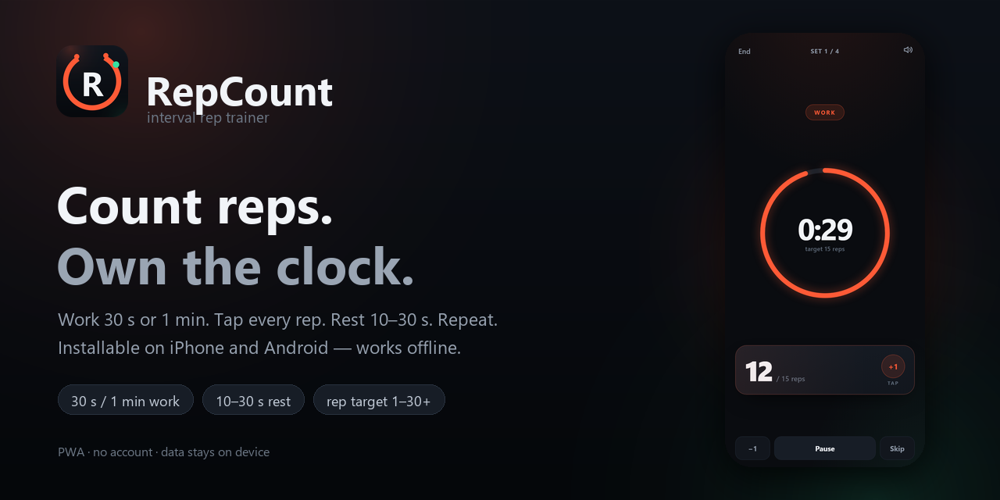
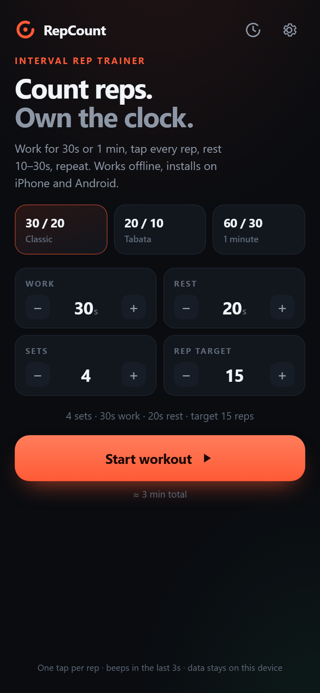
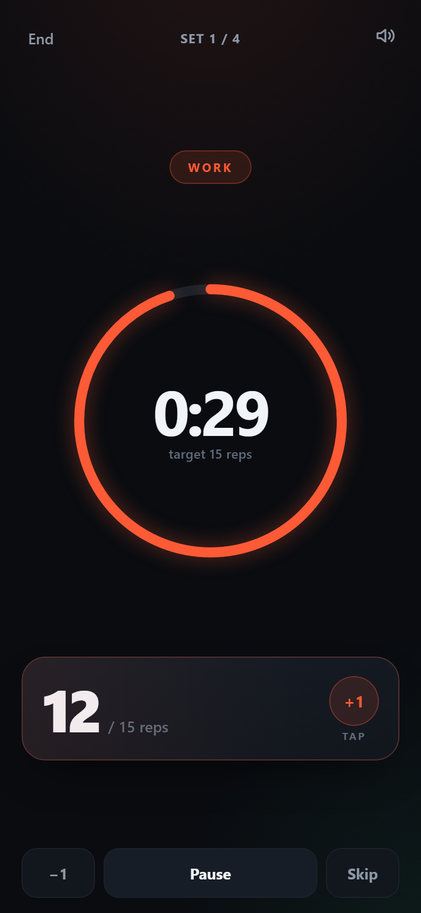
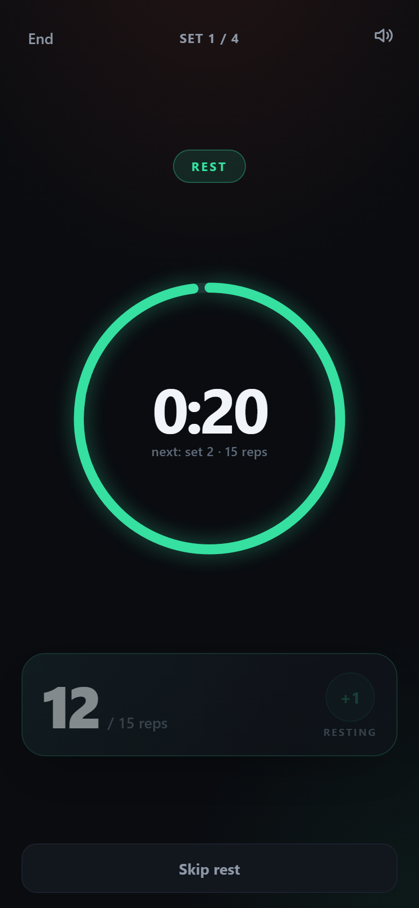
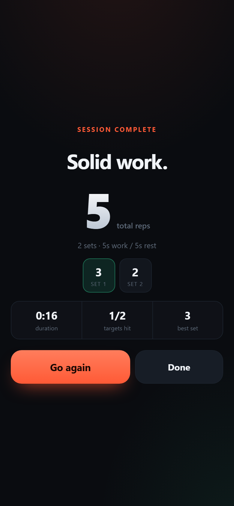
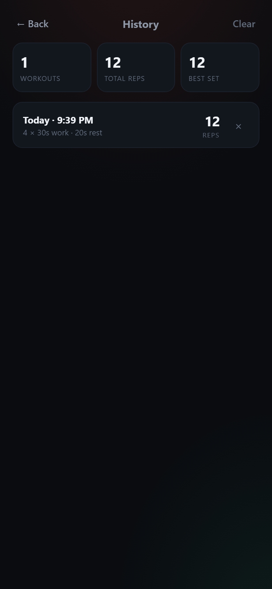

<p align="center">
  
</p>

<h1 align="center">RepCount</h1>

<p align="center">
  Count reps. Own the clock.<br>
  A tiny interval rep trainer that installs on <b>iPhone</b> and <b>Android</b> and keeps working offline.
</p>

<p align="center">
  <b>Live demo:</b> <a href="https://darker20121995.github.io/repcount/">darker20121995.github.io/repcount</a><br>
  <sub>Not live yet? Follow <a href="GITHUB.md">GITHUB.md</a> — one push and it's up.</sub>
</p>

---

## What it is

RepCount is a single-page **PWA** (progressive web app). No framework, no build step, no
backend — just `index.html`, one stylesheet and one script. Open it in a phone browser and
add it to the home screen; it launches full-screen and caches itself for offline use.

Set a **work timer** (30 s, 1 min, anything 5 s–5 min), a **rep target** (1–30+), a **rest
timer** (10/20/30 s) and the number of **sets**. Tap the big pad for every rep — the app
beeps the last three seconds, rolls into rest, then starts the next set by itself.

## Features

- **Work timer** — presets 30 s / 1 min, adjustable 5 s–5 min
- **Rep target** — 1–99 per set, with progress fill on the tap pad
- **Rest timer** — 10 / 20 / 30 s presets, auto-starts the next set
- **Sets** — 1–20 rounds, with per-set rep breakdown
- **One-tap counting** — whole pad is the button, `−1` fixes a mis-tap
- **Cues** — beeps for 3-2-1, set-change tones, haptics on Android
- **History** — total reps, best set, duration and per-set counts, stored on-device
- **Offline** — service worker caches the app shell
- **Installable** — full-screen on iOS and Android, no app store needed
- **Accessible** — large targets, ARIA labels, reduced-motion support

## Screenshots

<p align="center">
  
  
  
</p>

<p align="center">
  
  
</p>

## Install on your phone

The app must be served over **HTTPS** (GitHub Pages gives you that for free).

**Android (Chrome)**
1. Open your Pages URL.
2. Tap the **Install** card in the app, or Chrome's ⋮ menu → **Install app**.
3. It appears in the app drawer and opens full-screen, offline.

**iPhone / iPad (Safari)**
1. Open your Pages URL in **Safari** — not Chrome.
2. Tap **Share** → **Add to Home Screen** → **Add**.
3. Launch it from the home screen: full-screen, works offline after the first load.

## Run locally

```powershell
python -m http.server 4173
# then open http://127.0.0.1:4173
```

> A service worker only runs on `https://` or `localhost`. On a LAN address like
> `http://192.168.1.20:4173` the app still works, but it won't install or cache offline.

## Publish on GitHub Pages

Full walkthrough: **[GITHUB.md](GITHUB.md)** — or run `publish.ps1`
(right-click → **Run with PowerShell**) on Windows.

Short version:

1. Create a **public** repo named `repcount` at <https://github.com/new>.
2. Upload these files (or run `publish.ps1`) to the repo root.
3. **Settings → Pages → Source: Deploy from a branch → `main` / `/ (root)` → Save.**
4. Open <https://darker20121995.github.io/repcount/>.
5. On iPhone: Safari → Share → **Add to Home Screen**.

Every push to `main` redeploys the site automatically.

## Tests

The timer engine and UI are tested in headless Edge over the DevTools protocol:

```powershell
# terminal 1
python -m http.server 4173

# terminal 2 — headless Edge with remote debugging
& "C:\Program Files (x86)\Microsoft\Edge\Application\msedge.exe" `
  --headless=new --remote-debugging-port=9222 `
  --user-data-dir="$env:TEMP\repcount-edge" about:blank

# terminal 3
node tools/shots.mjs
```

20 checks cover counting, pause/skip, auto-advance, summary math, history persistence,
offline boot, service-worker control and small-screen layout. Screenshots are written to
`tools/shots/` (git-ignored).

## Project layout

```
/
├── index.html              # setup, workout, summary, history screens
├── styles.css              # dark mobile UI, safe-area aware
├── app.js                  # config, timer engine, counting, history, PWA glue
├── manifest.webmanifest    # name, icons, standalone display
├── sw.js                   # offline app-shell cache
├── icons/                  # app icons + favicon
├── screenshots/            # README / social-preview images
├── tools/
│   ├── make-icons.py       # regenerate the icon set (Pillow)
│   ├── make-banner.py      # regenerate screenshots/banner.png
│   └── shots.mjs           # headless test + screenshot suite
├── GITHUB.md               # step-by-step GitHub Pages guide
├── publish.ps1             # one-command git init + push helper (Windows)
├── LICENSE                 # MIT
└── .nojekyll               # serve files as-is on GitHub Pages
```

## Customize

| What | Where |
| --- | --- |
| Defaults & presets | `DEFAULT_CFG`, `PRESETS` in `app.js` |
| Limits (work/rest/sets/target) | `LIMITS` in `app.js` |
| Colors | CSS variables at the top of `styles.css` |
| Icons | edit `tools/make-icons.py`, then `python tools/make-icons.py` |
| Banner | edit `tools/make-banner.py`, then `python tools/make-banner.py` |
| Cache version | bump `VERSION` in `sw.js` when shipping asset changes |

## Data & privacy

Config, settings and workout history live in `localStorage` on the device. No analytics,
no accounts, no network calls after the first load.

## License

[MIT](LICENSE) — do whatever you like.
